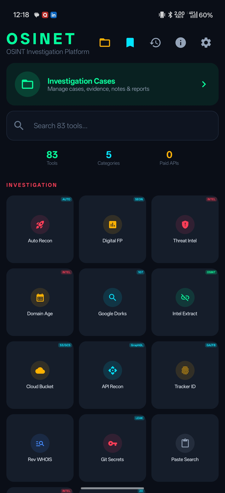
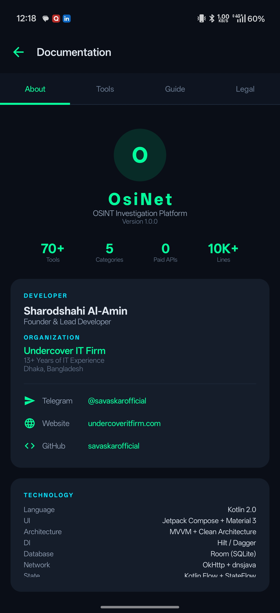
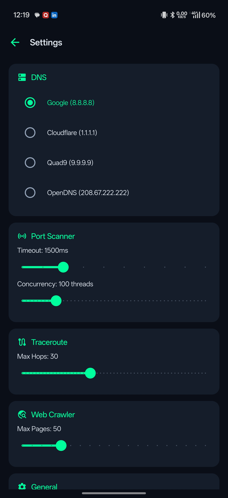

# OsiNet

**OSINT investigation toolkit for Android — Undercover IT Firm.**

84 tools across five categories, with case management, evidence, notes and readable offline reports. This repository contains documentation and screenshots. Application source code is not distributed here; APKs belong in **GitHub Releases**.

[Download APK](https://github.com/savaskarofficial/OsiNet/releases/download/apk-v1.0.7/OsiNet-1.0.7-debug.apk) · [Release notes](docs/RELEASE-v1.0.7.md) · [Changelog](CHANGELOG.md) · [Report an issue](https://github.com/savaskarofficial/OsiNet/issues/new/choose)

## Download

| Item | Current packaged build |
| --- | --- |
| APK version / versionCode | **1.0.7 / 8** |
| Build type | Debug / testing build |
| Android | 8.0+ (API 26); target API 35 |
| Package | `com.undercoveritfirm.osinet.debug` |
| APK size | 40.36 MB (40,360,859 bytes) |
| Release tag | `apk-v1.0.7` |
| Integrity | [SHA256SUMS.txt](https://github.com/savaskarofficial/OsiNet/releases/download/apk-v1.0.7/SHA256SUMS.txt) |

Download the APK from release **Assets**, not GitHub’s automatic “Source code” archives. Those archives contain only this documentation repository. The links above become available after the maintainer publishes the packaged assets.

The existing repository’s historical `v1.1.0` tag is retained. It does not establish the version inside the current APK. This build is tagged `apk-v1.0.7` to avoid rewriting that history or claiming an APK version that was not built.

### Install or update

1. Download the APK and optionally verify its SHA-256 checksum.
2. Allow installation from your chosen browser/file manager if Android asks.
3. Export important cases before upgrading. Install over an existing app only when package and signer match. The earlier delivery record identifies the same debug signer for supplied 1.0.5 and 1.0.6 builds; that does not guarantee compatibility with every older APK.
4. Open OsiNet and grant only the permissions needed for the tools you use.

This is the available debug APK, not a newly built production-signed release. A production build requires the private project and a maintained production signing identity. Do not uninstall or clear data merely to resolve an update error before backing up cases.

## Screenshots

  
  
  

These are the original supplied device screenshots. They may show an earlier build, tool count or version; they have not been altered to imply a new capture.

## Tool catalogue

The current 1.0.7 Home catalogue contains these entries. Counts describe available entries, not proof that every remote provider works on every device.

| Category | Count | Tools |
| --- | ---: | --- |
| Investigation | 15 | External Results, Auto Recon, Digital FP, Threat Intel, Domain Age, Google Dorks, Intel Extract, Cloud Bucket, API Recon, Tracker ID, Rev WHOIS, Git Secrets, Paste Search, Shodan, IP Blacklist |
| Network Recon | 22 | Ping, Port Scan, DNS Lookup, Whois, Traceroute, Subnet Calc, SSL Cert, GeoIP, Reverse DNS, Redirects, Speed Test, Ping Sweep, Latency Mon, ASN Lookup, Wake-on-LAN, DNS Propagation, Reverse IP, TLS Ciphers, ARP Table, Tor/Proxy, Dark Web, MQTT IoT |
| Web Recon | 16 | Headers, Tech FP, Subdomains, CMS Detect, WAF Detect, Robots.txt, Crawler, Cert Trans, HTTP Methods, CORS Test, Favicon Hash, Site Status, Wayback, Security.txt, Cookies, HTTP Diff |
| Social / People | 11 | Person Recon, Social Profiler, Breach Check, Username, Email OSINT, Email Dorks, Phone, Email Headers, Name→User, Reverse Image, People Dorks |
| Utilities | 20 | Hash Gen, Encoder, EXIF Data, MAC Lookup, PassGen, WiFi Info, Device Info, User Agent, Text Analyze, Meta Strip, JSON Format, IP Convert, Timestamp, cURL Gen, Regex Test, UUID Gen, Port Lookup, Crypto Recon, Shadow Calc, Infra Map |

## Recent improvements

- Traceroute enriches observed hops while the route is still running; Ping displays live output and retains partial results.
- Subdomain discovery combines certificate names, user input and DNS checks. Passive names are retained even without A/AAAA answers, with source and resolution status. Discovery remains partial.
- Person Recon supports saved observations containing source URL and query, linked to the selected case.
- Dork tools distinguish validated domain filters from keywords and document engine-dependent operators.
- About and Settings read the installed APK’s actual version metadata.
- HTML case reports use the app’s dark palette, navigation, result cards, structured fields/tables, investigator notes and print styling.
- Workbench and Web Research were removed from the user-facing catalogue; retained historical investigation data remains exportable.

## Cases and exports

| Record | How to retain it |
| --- | --- |
| Managed scan | Select the case **before** launching; final output belongs to that launch-time case, including partial/cancelled status. |
| Person Recon observation | Press **Save note** with the intended case selected. Unsaved drafts are not evidence. |
| Local generator / utility output | Use **Save reviewed output**. |
| Bookmark | Link it to the intended case. Unassigned bookmarks are not automatically included. |
| Earlier unassigned records | Selecting a case later does not retroactively attach them. |

Snapshot HTML and full HTML reports are readable, self-contained static reports. **Full HTML / full case ZIP** include additional retained investigation records; the ZIP includes `report.html`, attachment exports and integrity data. JSON, CSV, TXT and STIX remain data/text formats. HTML is not a live replica of the Android app, and not every intermediate response is preserved.

## Privacy and security

Case/history data uses a local Room database with SQLCipher. Exported reports, copied text and files shared with other apps leave that database’s protection. Keep sensitive exports private.

Network tools send queries to the chosen targets and third-party DNS, OSINT, search and other providers. These requests disclose query data and connection metadata to the receiving services. Browser handoffs and optional companion configurations introduce their own recipients. Local storage does not make remote queries anonymous.

Proxy/Tor behavior depends on the tool, protocol and configuration; do not assume every network path is covered. The manifest permits cleartext traffic for HTTP inspection. Metadata stripping or image pixel changes do not guarantee protection against reverse image search. Rate limits, blocks, provider changes and ambiguous matches can produce incomplete/inconclusive results; absence of a result is not proof of absence or identity.

See [SECURITY.md](SECURITY.md) for reporting vulnerabilities. Review diagnostics before posting: redact tokens, account data, target details and evidence you cannot publish.

## Permissions

| Permission | Purpose |
| --- | --- |
| Internet / network state | Network tools and connectivity checks |
| Wi-Fi state / change Wi-Fi state | Wi-Fi information and supported Wi-Fi operations |
| Fine / coarse location | Android-gated Wi-Fi information and location-aware features; IP geolocation is provider-derived |
| Media images / legacy storage (through API 32) | Image metadata/file workflows where applicable |
| Foreground service / data sync | Long-running scan service |
| Notifications | Scan notifications on supported Android versions |

Android/OEM permission limits can restrict ARP, Wi-Fi details, ICMP and long-running work. No privileged backend is implied.

## Validation and limitations

The supplied 1.0.7 verification record reports 75 passing JVM tests, successful build/lint with zero lint errors, and report previews at desktop/mobile widths. It also records **39 lint warnings and 6 informational findings**. Physical-device acceptance, document-provider saving, upgrades, large exports and comprehensive provider coverage remain open. This repository refresh does not rebuild or patch the APK.

## Contact and license

Developed by **Sharodshahi Al-Amin / Undercover IT Firm**. [Website](https://undercoveritfirm.com) · [Telegram](https://t.me/savaskarofficial) · [GitHub](https://github.com/savaskarofficial).

Proprietary software; see [LICENSE](LICENSE). Intended for authorized research and lawful investigations. Android and third-party service names belong to their respective owners.
